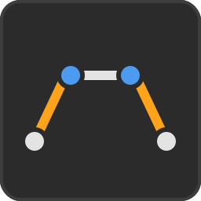
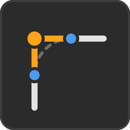
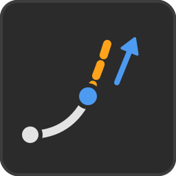
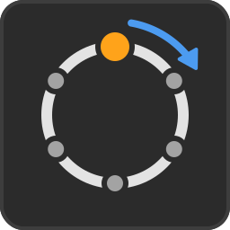
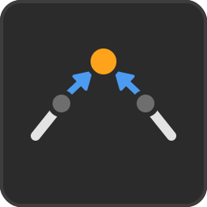
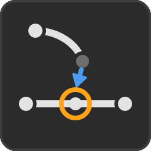

# Curve Toolkit

Tools to create, refine and operate on curves (Poly, Bezier and NURBS) for
Blender 5.2.

Independent Blender Extension, with its own installation, documentation and
icons (`etr_curves_toolkit`). Panel location:
**3D Viewport > Sidebar (N) > Eterea Curves**.

The tab holds one panel, *Eterea Curves Toolkit*, with one collapsible
sub-panel per section: *Create Curves*, *Curve Booleans*, *Shaping Splines*,
*Utilities*, *Change Origin*, *Global Settings* and *Documentation* (the
last four start collapsed; Global Settings holds the Threshold that several
tools share, and Documentation links to this page).

## Tools

### Create Curves

Four rows of icon buttons:

1. The five **Primitive Curves** (Object and Edit Mode).
2. Five **Circles from Points**: from Center & Point, from 2 Points, from 3
   Points, Inscribed in a Triangle, Tangent to 2 Segments.
3. Construction lines: Circle from **Segment & Center**, **Tangents to 2
   Circles**, **Tangents from Point** and **Perpendicular from Point**.
4. Construction points: **Lines from Points**, **Points in Between**,
   **Points Along Curve** and **Points at Intersections**.

The tools of this section, and of every other one, are described below in
the same order as in the panel.

####  Primitive Curves (Object and Edit Mode)

Five icon buttons that add a simple curve to the scene:

| &nbsp;&nbsp;&nbsp;&nbsp;&nbsp;&nbsp;&nbsp;&nbsp;&nbsp; | Button | Curve | Shape |
| :-: | --- | --- | --- |
|  | Line / Point | Poly, *Points* points (2 by default), open | A straight line on the X axis, from -Radius to +Radius, with its points evenly spaced. *Points* 1: a single stray point at the center |
|  | Bezier | Bezier, 2 points, open | The same curve as Blender's *Add > Curve > Bezier*, with the same Aligned handles |
|  | Rectangle | Poly, 4 points, closed | A rectangle on the XY plane, *Width* x *Height* |
|  | Polygon | Poly, N points, closed | A regular polygon on the XY plane, N = *Sides* |
|  | Circle | Bezier, 4 points, closed | The same circle as Blender's *Add > Curve > Circle*, with the same Auto handles |

All of them follow the conventions of Blender's own *Add* operators. Right
after the click, the *Adjust Last Operation* panel (bottom left, or F9) has,
in this order:

- the size first: *Points* (Line / Point, default 2, soft limit 99: 1 makes a
  single stray point, 3 or more subdivide the line evenly) and *Radius* (Line
  / Point, Bezier, Circle), *Width* and *Height* (Rectangle), *Sides*
  (Polygon, default 6) and *Radius*.
- *Align*: World, View or 3D Cursor.
- *Location* XYZ and *Rotation* XYZ.

In the **Edit Mode of a curve** the same buttons add their shape as one more
**spline inside that curve**, instead of a new object:

- It goes where *Location* says (the 3D Cursor by default), with *Align* and
  *Rotation* working as usual: they are read in world space and brought into
  the local space of the object being edited.
- The splines that were there are left alone and **only the new one ends up
  selected**, ready to be moved, offset or rounded.
- The size is the size in the **scene**, so the transform of the object is
  taken out of the shape. In an object with a non-uniform scale that means the
  spline is written pre-distorted, so that it still looks right in the
  viewport. It is what Blender does when a mesh primitive is added in Edit
  Mode.
- In an object whose *Shape* is **2D** the height of the new spline is ignored
  by Blender, so a *Rotation* out of the XY plane cannot be seen. A warning
  says so.
- In the Edit Mode of anything that is not a curve the five buttons are
  **disabled**.

Notes:

- **Units**. The size comes in at one unit of the length shown in the
  interface: `Radius = 1 m` in a metric scene, `1 cm` when the Length of the
  scene is set to Centimeters, `1 ft` in an imperial one, and so on (the
  *Unit Scale* of the scene is taken into account; without units, the grid of
  the viewport is). The Rectangle comes in at 2 x 2 of the same unit. This
  goes a bit further than Blender's own primitives, which only follow the
  *unit system* (so they would read `100 cm` in that example).
- The *Radius* of the Line is half its length, so the default Radius 1 gives a
  line of length 2, the same meaning Blender gives it in its own primitives.
- The first point of the **Polygon** is on the +Y axis (at 12 o'clock) and
  stays there when *Sides* changes. The first point of the **Circle** is on
  the -X axis, as in Blender's own circle.
- The closed primitives (Rectangle, Polygon, Circle) turn
  **counter-clockwise** seen from +Z, so the Booleans, Round Corners and the
  rest of the tools see all of them the same way. Blender's own Bezier circle
  turns clockwise, so this is the one difference with it.
- New curves are **3D** (Shape: 3D), as Blender's own ones. The Booleans and
  Splits turn flat 3D curves into 2D by themselves when they need to.

####  Circles from Points (Edit Mode of a mesh or a curve)

The second row of *Create Curves*, plus the first button of the third one
(*Segment & Center*): six icon buttons that draw a
**Bezier circle**, or an arc of it, from points that are already in the scene.

| &nbsp;&nbsp;&nbsp;&nbsp;&nbsp;&nbsp;&nbsp;&nbsp;&nbsp; | Button | Points | Active point (picked last) | Circle |
| :-: | --- | --- | --- | --- |
|  | Circle from Center & Point | 2 | the center | Through the other point |
|  | Circle from 2 Points | 2 | 6 o'clock | The two points are the ends of a diameter; the other one is at 12 o'clock |
|  | Circle from 3 Points | 3 | where it starts | The only circle through the three points, in their own plane |
|  | Circle from Segment & Center | 3 | the center | Tangent to the straight line through the other two points (the line, not only the segment between them) |
|  | Circle Inscribed in a Triangle | 3 | opposite the side where it starts | Tangent to the three sides of the triangle of the points, in their own plane |
|  | Circle Tangent to 2 Segments | 3 | the corner | Tangent to the two segments that meet at the corner, in the plane of the points. Its **Radius** (F9) starts as the one of the inscribed circle and can be changed: the circle slides along the bisector of the corner, always tangent to both |

**Where they work**

- **Edit Mode of a mesh**: the selected vertices. A **new curve object** is
  made (`Circle`, or `Arc`), selected, active and left in its **Edit Mode**,
  ready to be refined. Its origin is at the center of the circle and its
  rotation lays the circle flat on its local XY plane, so Offset and the
  Booleans can take it as it is.
- **Edit Mode of a curve**: the selected control points (handles do not
  count), in any spline. The circle goes into **that same curve** as one more
  spline, the Edit Mode is kept, and only the new spline ends up selected.
- In Object Mode, or in the Edit Mode of anything else, the buttons are
  **disabled**. A wrong number of selected points gives a message that says
  what each tool expects.

**Plane.** Except for *3 Points*, *Inscribed* and *Tangent to 2*, whose
plane is the one of their points, the
circle is drawn on a world plane chosen by the view of the 3D Viewport when
the button is clicked:

| View | Plane | Coordinate taken from the active point |
| --- | --- | --- |
| Top / Bottom | XY | Z |
| Front / Back | XZ | Y |
| Right / Left | YZ | X |
| User Perspective / Camera | XY (as Top) | Z |

The points are projected onto that plane (their absolute coordinates on it),
at the height of the active point. An axis view in perspective (Numpad 5)
still counts as that view. The *View* field of the *Adjust Last Operation*
panel (F9) shows the one that was used, and can be changed there.

**Options (F9)**

In this order: *Radius* (*Tangent to 2* only, first), *Oriented*, *Toggle
Goal* or *Goal*, *Arc*, *Angle*, *Normal Rotation*, *Add Helper Points* (every
tool but *Center & Point*) and, last, *View* (the tools drawn on the plane of
the view).

- *Radius* (*Tangent to 2* only), see above.
- *Toggle Goal* (2-point tools) or *Goal* (3-point tools): which point plays
  the part of the active one. It starts at the active point; *Toggle Goal*
  swaps the two points, and *Goal*, three small buttons **1 / 2 / 3** (in the
  order of the selection, or of the curve; the chosen one highlighted), picks
  any of the three. In *Inscribed* it picks the side where the circle starts
  (the one opposite the Goal point); in *Tangent to 2*, the corner, and so the
  pair of segments the circle touches.
- *Oriented* (on by default): the circle **starts** (its point at 12 o'clock)
  at the start point of the tool: the point on the circle (*Center & Point*),
  the non-active point (*2 Points*), the active point (*3 Points*) or the point
  where the circle touches the line (*Segment & Center*), the side opposite
  the Goal point (*Inscribed*) or the first segment from the corner
  (*Tangent to 2*). Off: the four points
  sit on the axes of the plane, the first one at 12 o'clock (up on the
  screen), as in a circle added the usual way.
- *Arc* (off by default): only **Angle** degrees of the circle (180° by
  default, from -360° to +360°), from the start. A positive angle turns
  **clockwise** and a negative one **counter-clockwise**, both as seen from
  the view. ±360° gives the whole circle again.
- *Normal Rotation* (0° by default, no limits): turns the circle or arc about
  the axis through its center, normal to its plane (clockwise when positive,
  as seen from the view).
- *Add Helper Points* (off by default; every tool but *Center & Point*): also
  adds **stray control points**, **Poly** splines of a single point like
  every other construction point of the toolkit (so extruding them makes
  straight segments, with no handles to tidy up), at every point where the circle
  **touches a line** (*Segment & Center*, *Inscribed*, *Tangent to 2*), even
  when an arc does not reach it, and at the **center** of the circle when the
  center was not one of the picked points (*2 Points*, *3 Points*,
  *Inscribed*, *Tangent to 2*).

The whole circle has four points with **Auto** handles, like Blender's own
Bezier circle, and turns clockwise from its start, as seen from the view. An
arc has one point every 90° at most (180° gives three points), with
**Aligned** handles; the outer handles of its two ends carry on along the
circle, so they can be picked and dragged.

**The active point of a curve.** Blender keeps the order in which mesh
vertices are picked (select history), so with a mesh the active vertex is
always known. For curves Blender does not give add-ons the active control
point, only the **active spline** (the one of the point clicked last). So the
active point is found as the only selected point of the active spline, which
works whenever each point was clicked in a different spline. When that does
not tell it (two of the points in the same spline, or a box selection), the
points are taken in the order of the curve, the last one as the active one.
Either way, *Toggle Goal* and *Goal* change it on the spot.

####  Tangents to 2 Circles (Object and Edit Mode)

Third row of *Create Curves*. Draws the **straight lines tangent to two
circles**: the two outer ones (the lines of a belt around two pulleys), as
straight Bezier segments with **Vector** handles.

- The two circles can be **two curve objects** (one closed spline each), **one
  curve object with two splines** (Object Mode), or **two splines picked in
  Edit Mode** (any selected point of a spline picks it).
- A spline counts as a circle when its shape is one (any number of points,
  Bezier or Poly), measured in the scene: a circle scaled non-uniformly is an
  ellipse and is refused. The two circles must lie in one common plane (any
  plane), and neither may be fully inside the other.
- Two splines of **one object**: the lines are added to that object. Two
  **objects**: they go to a new third object, `Tangents`, with the look and
  transform of the active one. In Edit Mode the new object is left selected,
  in Object Mode.

Options (F9):

- *Add Crossing Tangents*: also the two **inner** tangents, the ones that
  cross between the circles. They only exist when the circles do not overlap;
  otherwise a warning says so and only the outer ones are drawn.
- *Boolean All*: instead of the lines, the **closed shape** of the two circles
  and their outer tangents, joined and merged, always as a new object (`Belt`)
  so the circles are never touched: **Vector** handles along the straight
  sides, **Aligned** ones on the arcs. The circles (their object or objects)
  are **hidden**, so only the new shape is left in view. The crossing
  tangents do not apply.

####  Tangents from Point (Edit Mode)

Third row of *Create Curves*. Draws the **two straight lines that start at a
point and touch a circle**.

- Select **one point** (a stray point, or a control point of any spline) and
  **one or more points of the circle** (a closed Poly or Bezier spline whose
  shape is a circle, as for Tangents to 2 Circles).
- The two lines are **Poly** segments of two points, independent: they are
  not merged with the circle at the points where they touch it. They go into
  the curve being edited and are left selected.
- The point may be out of the plane of the circle: the lines still touch it
  (they are tangent in 3D). A point **inside** the circle, or on it, has no
  tangents and is refused.

####  Perpendicular from Point (Edit Mode)

Third row of *Create Curves*. From every **selected control point** of a Poly
or Bezier spline, a new straight segment that leaves the curve
**perpendicularly**. It is a spline of its own, not connected to the curve:
always a **Poly** spline, whatever the type of the curve.

- A smooth point (aligned handles, or a Poly point between two segments in
  line) gets the **perpendicular**; a positive *Length* goes to the **left**
  of the direction of the curve, as seen from the view.
- A **corner** gets the **bisector** instead: of its two handles on a Bezier
  spline, of its two segments on a Poly one. A positive *Length* goes
  **outwards**, away from the inside of the corner.
- An end point of an open spline gets the perpendicular to its only side.
- The segment stays in the **plane of the view**, as with the Circles from
  Points: Top/Bottom XY, Front/Back XZ, Right/Left YZ, a free perspective or
  the camera view as Top. *View* in the F9 panel shows it and can change it.
- *Length* (F9): starts at **a quarter of the length of the spline** of the
  first selected point; negative values go to the other side. Several
  points can be done at once, all with the same Length. NURBS are skipped.

####  Lines from Points (Edit Mode of a curve or a mesh)

The fifth button of the third row of *Create Curves*, just before *Points in
Between*. It **joins the selected points with straight lines**, without merging
anything: the lines get points of their own, laid exactly over the selected
ones. Meant for **construction guides**, so the points do not have to be on one
plane.

- **2 points**: one open, straight segment.
- **3 points or more**: a **closed shape** through all of them, with **no
  crossings** (see below). *Closed* (F9, on by default) can leave it open
  instead: the shortest open line through all of them. Points that are all on
  one straight line always give an open line, from one end to the other.
- **Edit Mode of a curve**: selected control points (handles do not count), of
  any type, of one curve or of several (multi-object editing). The lines are a
  new **Poly** spline of the **active curve**.
- **Edit Mode of a mesh**: selected vertices, of one mesh or of several. The
  lines are new **vertices and edges** of the **active mesh**.
- The Edit Mode is kept and **only the new points end up selected**, ready to
  be moved. Two selected points at the very same place count once.

**The order of the points.** Blender does not keep the order in which control
points are picked, so it is worked out from where the points are:

- First, when the points lie on a plane of the axes (XY, XZ or YZ: a Top,
  Front or Side view), they are tried as the **corners of a shape whose sides
  all run along the axes**: a rectangle, an **L**, a **T**, an **H**, a
  **cross**, a stair... Such a shape is unique: on every line parallel to an
  axis its corners pair up, first with second, third with fourth. When that
  gives one closed outline through every point, with no crossings, that is the
  shape.
- Otherwise, the **shortest closed path** through all the points. On a plane
  it never crosses itself; when the points are the corners of a convex shape
  (a polygon, a slanted quadrilateral...) it is exactly its outline, and it
  also follows many concave ones. Up to 12 points it is the exact shortest
  path; with more, a very close one (built from several starting points and
  improved until no crossing is left).

Points **inside** a shape, or a concave shape that is not drawn along the axes,
may be joined in an order other than the intended one. The quickest way round
is to build it from simpler pieces (four points for a rectangle, for instance)
and join them with the Booleans.

####  Points in Between (Edit Mode of a curve or a mesh)

Fourth row of *Create Curves*. With **two points
selected** it adds new points evenly spaced on the **straight line** between
them, in 3D space (wherever the two points are): handy to find centers, or to
lay out divisions to snap to.

- *Count* (Adjust Last Operation panel, F9; default 1, soft limit 100): 1 puts
  one point at the exact middle, 2 puts two at 1/3 and 2/3, and so on.
- **Edit Mode of a curve**: two selected control points (handles do not
  count), in one spline or in two. Every new point is a **stray point**: a
  **Poly** spline of its own with a single point (so extruding it makes
  straight segments, with no handles to tidy up), added to the active curve.
  *Select Strays* finds them all again.
- **Edit Mode of a mesh**: two selected vertices. The new points are **loose
  vertices** of the active mesh.
- The Edit Mode is kept and **only the new points end up selected**. In
  multi-object editing the two points can be in different objects; the new
  ones go into the active one, at the right place in the world.

####  Points Along Curve (Object and Edit Mode)

Fourth row of *Create Curves*. Puts **Count** stray points on each spline,
spread along it at **equal lengths**, without splitting it or changing its
shape.

- *Count* (F9; default 4, soft limit 99): 1 point goes to the middle (two
  halves of the same length), 2 points to 1/3 and 2/3, 3 points to 1/4, 2/4
  and 3/4, and so on. A **closed** spline is measured the same way, from its
  first point (which is also the last one).
- *Add at Extremes* (F9): also adds a point at **each end** of an open spline,
  or **one** at the first point of a closed spline.
- **Object Mode**: every spline of the selected curves; the points go into a
  **new curve object** (`Curve Points`), left selected, active and **in Edit
  Mode**, since stray points cannot be seen in Object Mode.
- **Edit Mode**: the splines with a selected point (one point per spline is
  enough); the points go into the **same curve**, and only they are left
  selected.
- **Only one segment**: in Edit Mode, a spline with exactly **two consecutive
  control points** selected (N and N+1, or the last and the first of a closed
  spline) gets the points only along the **segment between them**, measured
  from N (with *Add at Extremes*, N and N+1 get one too). One point, two
  points that are not consecutive, or three or more: the whole spline, as
  usual. Poly and Bezier (a NURBS spline always gets them along all of it).
- Every point is a **stray point**: a Poly spline of its own with a single
  point. The lengths are measured in the scene (world space). Poly and Bezier
  splines are exact (the points are on the curve itself); NURBS splines are
  measured on the polyline Blender evaluates for them, a very close
  approximation.

####  Points at Intersections (Object and Edit Mode)

Fourth row of *Create Curves*. Adds a stray point **exactly where two splines
cross**, without cutting them or changing their shape.

- **Object Mode**: every spline of the selected curves; the points go into a
  **new curve object** (`Intersection Points`), left selected, active and
  **in Edit Mode**, since stray points cannot be seen in Object Mode.
- **Edit Mode**: the splines with a selected point (one point per spline is
  enough); the points go into the **curve being edited**, and only they are
  left selected.
- Every crossing counts: between splines of different curves, between
  splines of the same curve, and a spline that crosses **itself**. Two
  crossings at the same place give one point.
- Poly and Bezier splines, also mixed, are exact. NURBS splines are evaluated
  by Blender into a dense polyline, so their crossings are a very close
  approximation.

Splines that **really touch** always get the point at its real place. Splines
that only **seem** to cross (they are at different depths) depend on the view
the button is clicked in (*View*, F9):

| View | Point added |
| --- | --- |
| Orthographic Top / Bottom | where they cross on the screen, at **Z = 0** |
| Orthographic Front / Back | the same, at **Y = 0** |
| Orthographic Right / Left | the same, at **X = 0** |
| Perspective, camera or rotated view | **none**: a warning says how many were left out |

### Curve Booleans

The tools that make new curves from the selected ones and keep the originals
as backups, all in Object Mode: the three **booleans** as icon buttons;
**Symmetrize**, a little apart under them; the **Splits** (Split Active and
Split All side by side, then Split at Control Points and Split at Stray
Points); and the two options of the **Sources and Results collections**,
which all of them share.

####  Union, Intersection, Difference (Object Mode)

2D boolean operations between closed curves, as three icon buttons:

| &nbsp;&nbsp;&nbsp;&nbsp;&nbsp;&nbsp;&nbsp;&nbsp;&nbsp; | Button | Curves | Result |
| :-: | --- | --- | --- |
|  | Union | 2 or more | The union of all of them (order and active object do not matter) |
|  | Intersection | Exactly 2 | The common area |
|  | Difference | Exactly 2 | The active curve (selected last) bites the other one |

- Every spline of the selected objects must be a **closed** Poly or Bezier
  spline. NURBS are not supported. An object may have **several splines**: a
  shape with holes (a big circle already bitten by a small one) or several
  islands. Its splines make one region, even-odd, the way Blender fills a 2D
  curve, so a hole stays a hole in the result. Two splines of one object that
  cross each other count as that overlap being outside the shape, as Blender
  shows it.
- 3D curves that are flat (all their points at z = 0 in their local space) are
  turned into **2D curves automatically**. A 3D curve that is not flat gives a
  message and nothing is changed.
- The curves can be anywhere and rotated (XY, XZ, YZ or any other plane, at any
  height), as long as they all lie in the **same plane**. They are checked in
  the local space of the active object; if they are not coplanar, nothing is
  done and a message explains why.
- The result is a new object, `Curve Boolean`, with the transform and the look
  (bevel, fill, materials...) of the active object. The originals are hidden,
  never modified (apart from the automatic switch to 2D).
- If all the curves are Poly the result is Poly. Otherwise it is Bezier, and
  the Poly sides get Vector handles (as Set Spline Type does).
- The result can have several contours: disjoint pieces, or holes (a
  Difference that leaves a hole gives an outer and an inner spline).
- The shape is exact: intersections are computed on the real Bezier curves (not
  on a polygonal approximation), the curves are cut there with de Casteljau,
  and edges shared by both curves are handled. Original points that survive
  keep their handle type (Auto handles become Aligned); the new points at the
  crossings are corners with Free handles.

####  Symmetrize (Object Mode)

In the *Curve Booleans* group, a little apart under the three booleans.
**Mirrors one side** of the selected curves onto the other side and **welds**
them on the axis: the side that is kept is copied, mirrored, and replaces the
other side.

Everything is **relative to the view**, which must be an **orthographic axis
view** (Top, Bottom, Front, Back, Right or Left). In a perspective or camera
view it does nothing and says so, but the F9 panel still opens, so a *View*
can be picked there. Options (F9):

- *Direction*, four arrows: **Left to Right** (the default: the left side is
  kept and mirrored onto the right one, which goes away), **Right to Left**,
  **Top to Bottom** and **Bottom to Top**. Left and right are those of the
  screen: the left of Front is the right of Back.
- *Center*: where the mirror axis goes through: **World Origin** (the
  default), **Object Origin** (each curve uses its own) or **3D Cursor**. The
  axis is the vertical line of the screen through it (Left / Right
  directions) or the horizontal one (Top / Bottom).
- *View*: the view the button was clicked in.

What it does with each kind of spline:

- **Closed** splines are one region, the way Blender fills them (a shape with
  holes counts as one): the part on the kept side is joined with its mirror
  image into one symmetric outline, welded where it meets the axis.
- **Open** splines are cut where they cross the axis; every piece on the kept
  side gets its mirror image, welded to it on the axis. A piece with **both
  ends on the axis** becomes a **closed** spline: draw half a shape with both
  ends on the axis and Symmetrize closes it.
- A shape that does not reach the axis is left as it is, next to its mirror
  copy. A curve with nothing on the kept side is left untouched, and a
  message says so. When **none** of the curves has anything on the kept side
  (all of them are on the right, with Left to Right), nothing is made, but
  the F9 panel still opens: change the *Direction* there (Right to Left) and
  the mirror is done.
- Points welded on the axis get **Free** handles, so Blender does not realign
  them; the others keep their handle types.

Each selected curve gives a **new curve object** with its look. The
originals are always kept as **backups**: hidden, or in the Sources
collection, and the results can go into the Results collection (see *Sources
and Results collections*). Poly and Bezier curves (Poly when every spline is
Poly), open or closed, flat in a plane facing the view. NURBS are refused.

####  Curve Splits (Object Mode)

Cut 2D curves where they cross other selected curves. Unlike the booleans,
open curves are allowed: an open curve can cut a closed one, several open
curves can cut each other, and so on.

-  **Split Active**: only the active curve is cut, by all the others.
-  **Split All**: every selected curve is cut by all the others, **and where it
  crosses itself**: a curve that loops over itself (a figure eight, a
  four-leaf shape...) is cut at every one of its own crossings, so **a single
  curve can be split on its own**. Everything is cut by everything: the
  splines of one object cut each other too, and so does a single cubic that
  loops. It needs **no active object**, so it works right after a Select All
  or a box selection, where none of the selected curves is active.
- Every piece becomes a new object (`Split_01`, `Split_02`...) with the look
  and transform of the curve it comes from. Poly pieces stay Poly and Bezier
  pieces stay Bezier. All the selected originals are hidden (or go into the
  Sources collection, see below).
- Same requirements as the booleans: Poly or Bezier curves in the same plane
  (flat 3D curves are turned into 2D automatically). With **Split Active**,
  the splines of one object do not cut each other and loops are not cut; it
  needs two curves and an active one.
- An end of an open curve that only touches another curve is not a cut. A
  closed curve cut at a single point becomes one open piece whose ends meet.

 **Split at Control Points** (Object and Edit Mode, under Split Active and
Split All): Every segment between control points becomes a new curve object (`Split_01`, `Split_02`...). The original stays hidden. Edit Mode: cuts only at the selected points. It uses the Sources / Results collection options. Poly and Bezier only.

**Split at Stray Points** goes right under it.

**Split at Stray Points** (Object and Edit Mode, no icon) cuts the splines of a
curve where **stray points** of the same curve lie on them (the ones *Points
at Intersections*, *Points Along Curve*, *Points in Between* or *Add Line /
Point* make), instead of at its own control points:

- **Object Mode**: every selected curve that has stray points on its splines.
  Only the stray points of the **same object** count: stray points cannot be
  seen in Object Mode, so the ones of other objects are left out. Splines that
  no stray point touches become objects of their own too, unchanged.
- **Edit Mode**: only the splines with a **selected control point** are cut,
  and only by the **selected stray points**. Each curve being edited is cut by
  its own. It ends in Object Mode, with the pieces selected.
- "On a spline" means within the **Threshold** of *Global Settings*. In an
  **orthographic** Top, Front, Right... view it is enough for the point to be
  **seen** on the spline (the distance is measured on the screen), even if it
  is in front of or behind it; in a **perspective** or camera view it has to
  really touch it. *View* (F9) keeps the view the button was clicked in.
- Every piece becomes a new object (`Split_01`, `Split_02`...) and the
  original is kept as a backup, hidden or in the Sources collection, with the
  *Place Sources* / *Place Results* options like every other Split. The shape
  does not change: a Bezier segment is divided with de Casteljau and the new
  point gets Aligned handles. A stray point near a control point cuts at that
  point. A closed spline cut at a single point becomes one open piece.
- Poly and Bezier; NURBS splines are never cut (they are kept whole).

#### Sources and Results collections

Two options under the Booleans and Splits, shared by all of them (Union,
Intersection, Difference, Symmetrize, Split Active, Split All, Split at
Control Points and Split at Stray Points), both off by default:

- *Place Sources inside a Collection*: the original curves are moved into the
  collection `Curve Boolean Sources`, and the collection is **excluded from
  the View Layer** (the checkbox before the eye in the Outliner) instead of
  hiding the curves one by one. A later operation enables it, adds its own
  sources and excludes it again. Tick the checkbox to bring them all back.
- *Place Results inside a Collection*: the new curves go into the collection
  `Curve Boolean Results`.

If a collection with that name already exists in the scene it is reused,
wherever it is in the Outliner. Otherwise it is created inside the collection
of the active source. When both are in the same collection, `Curve Boolean
Sources` is always kept **above** `Curve Boolean Results` in the Outliner
(also when the Results collection was made first: it is moved below, keeping
its View Layer settings and the hidden state of its curves). Without *Place Sources inside a Collection* the sources
are hidden instead. The visibility of the Results collection is never
changed.

### Shaping Splines

The tools that reshape a spline, in one sub-panel (open by default): **Round**
and **Bridge** side by side with **Arcs to Corners** right under them;
slightly apart, **Offset**, **Extend**, **Slide Point**, and **Slice** with
**Undo Slice** next to it; and last, slightly apart again, **Handles to Axis**
and **Handles to Lines**. All with their icon, except Undo Slice. They are
described below in that order.

####  Rounds, Bridge & Corners (Edit Mode)

 **Round Corners** replaces every selected corner by an arc tangent to both
sides (a true fillet), also when one or both segments are curved. The rest of
the curve keeps its exact shape: curved segments are trimmed at the tangent
points with de Casteljau. Radius and Tension are editable right after the
click in the *Adjust Last Operation* panel (bottom left, or F9).

- *Radius*: radius of the circle tangent to both sides (no upper limit: drag
  or type any value).
- *Tension* (default 1.0, no upper limit): 1.0 gives a circular arc, 0.0 a
  straight bevel between the two tangent points, and higher values stretch the
  Bezier handles for a sharper rounding. Very high values on sharp corners can
  make the rounding loop over itself.

- Works on Poly splines and on Bezier splines. Arcs are cubic Beziers, so a
  Poly spline becomes a Bezier spline (the other corners keep Vector handles).
- Handle types: sides along straight segments get Vector handles (at 1/3 of
  the segment, so with Tension 0.0 the bevel's points can be selected and
  rounded again); points between two curved segments get Aligned handles (no
  pinch when one handle is moved). Where the arc meets a straight side, its
  handle is **Aligned** too, in line with the Vector one, so moving it keeps
  the joint smooth. Other curved sides are Free.
- Several corners can be rounded at once. When two neighbouring corners are
  rounded, each arc may use at most half of the segment between them; a radius
  that does not fit is reduced.
- Works in 3D (the corner defines its own plane).
- A closed spline of only **two points** (a drop, a lens) works too: both
  sides of the corner reach the same neighbour, along two different segments.
- On curved corners the fillet is solved numerically (the curves offset by the
  radius are intersected and refined with Newton's method). When the requested
  radius does not fit, the largest one that fits is used.
- NURBS are not supported.

 **Bridge Curves** joins two selected end points with a Bezier segment that
follows the tangent of both curves, without changing either curve. Select
exactly two end points of open splines (two splines of one object, or one
spline in each of two objects).

- *Tension* (default 1.0, no upper limit, in the F9 panel): the length of the
  handles is `Tension * distance / 3`. 0.0 gives a straight segment. Dragging
  goes up to 4.0; higher values can be typed.
- Two splines of the same object are welded into a single Bezier spline. If
  the two points are the two ends of the same spline, it is closed.
- Two different objects: a new `Bridge` object is created, with the look of the
  active object, and the originals are not modified.
- Poly splines are converted to Bezier when they are welded.
- Handle types follow the same rules as Round Corners: Vector along straight
  segments (Tension 0.0 gives Vector handles at 1/3), Aligned where two curved
  segments meet.
- Works in 2D and 3D. Poly and Bezier only.

####  Arcs to Corners (Edit Mode)

**Arcs to Corners** is the inverse of *Round Corners*: it brings back the hard
corner a curved segment was rounded from. Its button is in the same group,
slightly apart under *Round* and *Bridge*.

Select **two consecutive control points** and the two handles that shape the
segment between them are prolonged until they meet; a new control point with
**Vector** handles is placed at that meeting point, so both sides of the corner
come out straight. The two original points are left **selected with their
handles** and the new corner **unselected**, so a *Dissolve* right after
removes exactly those two points and leaves the hard corner alone. *Round
Corners* leaves its own two points selected, so the two buttons can be pressed
one after the other with nothing to reselect, and the corner lands back where
it was.

**Several pairs at a time**: every pair of consecutive selected points is
solved, so selecting the whole of a rounded rectangle un-rounds its four
corners in one press (its straight sides have parallel handles and are left
alone). A pair that is **not** selected is never touched, so a corner can be
kept rounded on purpose. On a closed spline the pair from the last point to the
first counts as well.

A segment is **left alone**, and the report says how many were, when its
handles do not meet in front of both points:

- a **straight** segment, and an **exact half turn**: parallel handles, no
  meeting point at all;
- an **S** shape, and handles pointing backwards: they would meet *behind* the
  points, putting the corner on the wrong side;
- an **almost** straight segment or an **almost** half turn (over 179.4
  degrees), whose meeting point lies absurdly far away: more than a hundred
  times the distance between the two points;
- in 3D, two handles that are **not in the same plane**: they never meet. No
  plane is asked of the spline as a whole, though: every segment is solved on
  its own, so a flat segment of a warped 3D spline works too, whatever its
  orientation. The gap accepted as a meeting point is a ten-thousandth of the
  distance between the points, which covers the single precision of curve
  coordinates and nothing more.

Notes:

- **Poly and NURBS** splines have no handles to prolong (a Poly segment is
  straight), so they are ignored and the report says so.
- The handles that now aim at the corner become **Free**, and so does any
  **Auto** handle of the two points, on either side: Blender recomputes an Auto
  handle from the neighbouring points, and the corner is a new neighbour that
  would bend the previous and the next segment, which have to stay as they are.
  A **Vector** handle stays Vector, and an **Aligned** handle on the outer side
  stays Aligned (the direction of the inner handle does not change, so there is
  nothing to re-align). Those handles are put at **a third of the way** to the
  corner, the length a Vector handle takes on a straight segment.
- *Dissolve Originals* (off by default, in the *Adjust Last Operation* panel,
  F9) runs Blender's own *Dissolve Vertices* right after, which removes the two
  original points and refits the segments around the corner. It is off so that
  the curvature next to the corner can be looked at first, which is the whole
  point of leaving the two points selected.
- Radius, tilt and softbody weight of the new corner are the **average** of the
  two points, so a bevel or a taper along the curve does not jump at it.

####  Curve Offset (Object and Edit Mode)

**Offset** creates a curve parallel to every selected one, at a signed
*Distance*. The button is in *Shaping Splines*, under *Arcs to Corners*.

In **Object Mode** the originals are not modified and stay visible; each one
gets a new object, `Curve Offset`, with its look (bevel, fill, materials...)
and its transform. The new curves end up selected, so they can be offset again
right away.

*Duplicate* (F9, on by default) is what gives that copy, and the new spline of
the Edit Mode below. **Turned off, the original is replaced by its offset**:
in Object Mode the curve object itself becomes its offset (curve data shared
with other objects is made single user first), and in Edit Mode the selected
splines are replaced by theirs.

In the **Edit Mode** of a curve no new object is made: the offset of every
selected spline goes **into the same curve**, as a new spline right after the
one it comes from, which stays where it was.

- A spline with only some of its points selected is taken **whole**, which is
  the *Select Linked* one would do by hand. On a Bezier spline a selected
  handle is enough.
- Only the offset is left **selected**, so it can be offset again right away.
- One spline can give **more than one**, where *Clean Overlaps* cuts it in two.
- A spline that the Distance eats whole gives nothing, so it is **left alone**
  and the report says how many.
- The object is **never converted from 3D to 2D** (that is a setting of the
  whole object, and the other splines are none of our business): the selected
  splines simply have to be flat in the local XY plane, which is checked
  before anything is written.
- Several curve objects in Edit Mode at the same time are handled.

- *Distance* (F9 panel): on a **closed** curve, positive goes **outwards** and
  negative **inwards**, whichever way the curve turns (clockwise or not). On an
  **open** curve, positive goes to the **left** of its direction and negative
  to the right. It is a length in the scene, so the scale of the object is
  taken into account (a non-uniform scale in X / Y cannot be honoured exactly
  and is reported).
- *Corners*: how a corner that opens a gap is closed.
  - **Miter** (default): both sides are prolonged until they meet. Between two
    straight sides they are simply made longer, so the offset of a rectangle is
    again a rectangle with four points.
  - **Round**: an arc of radius equal to the Distance, which is the exact
    offset of the corner.
  - **Bevel**: a straight segment between the two sides.
- *Miter Limit* (default 4.0, only with Miter): the longest miter, as a
  multiple of the Distance. A corner so sharp that its miter would shoot
  further out than this gets a bevel instead.
- *Clean Overlaps* (on by default): removes the parts that fold back over the
  curve, which appear on concavities tighter than the Distance, and where a
  closed curve is shrunk past its own width. Turn it off to see the raw offset
  of every segment.
- *Both Sides* (off by default): one parallel on **each** side of the curve
  instead of one. The **sign of the Distance then means nothing**: there is a
  parallel either way, so it is used as a width. In Object Mode both go into
  the **same** new object; in Edit Mode both go into the same curve, right
  after the spline they come from.
- *Join Both with Arcs* (off by default, greyed out until *Both Sides* is on):
  closes the two parallels of an **open** spline with a **half circle of radius
  equal to the Distance** at each end, so the pair comes out as a **single
  closed curve**. A **closed** spline has no ends to join, so it simply keeps
  its two parallels, inside and outside.

Each half circle is built as **two quarters**, which is one control point of
its own between the two ends of the parallels - the fewest a round half turn
can have. One cubic per quarter is off by 0.03% of the radius, which is
invisible; one cubic for the whole half turn would be off by a few percent,
which is not. A Poly spline becomes a **Bezier** one when the arcs are added,
for the same reason Round corners do that: an arc is not something a Poly
spline can hold.

**Handles.** On an open Bezier offset, the **outer handle of each end** is laid
**in line with the inner one**, with the length of the outer handle of the
original end (or of the inner handle, at an end made by a cut), and both are
**Aligned** (a Vector inner handle stays Vector). Every point where the offset
runs smooth, with its two handles in line, gets **Aligned** handles instead of
Free ones: the joints of the half circles with the parallels, the points in
the middle of the half circles, and the points the offset adds along curved
stretches. Moving one handle there keeps the curve smooth.

When *Clean Overlaps* cuts an offset into several pieces or eats an end away -
which happens when the Distance is larger than a concavity of the curve - the
ends the arcs would close onto are no longer there. The two parallels are then
left as they are, unjoined, and the report says how many splines that happened
to. Lowering the Distance, or turning *Clean Overlaps* off, gets the arcs back.

Notes:

- **Bezier curves stay Bezier**. The parallel curve of a Bezier segment is not
  a Bezier curve, so it is approximated: the segment is cut where the offset
  would have a cusp, and each piece becomes a cubic whose ends and tangents are
  exact and whose handles are solved so that it also passes through the exact
  offset of its midpoint. The piece is halved until the error is under 0.05% of
  the size of the curve, so a few extra control points appear only where one
  cubic is not enough. The offset of a Bezier circle still has four points.
  (Blender's own offset turns Bezier curves into polylines.)
- **Poly curves stay Poly**, with Miter or Bevel corners. With Round corners
  the arcs make it a Bezier curve.
- Points that reach the result untouched keep their radius, tilt and (when it
  is still valid) their handle type; Auto and Aligned become Aligned, so the
  shape is exactly the offset one but moving one handle still moves the other.
  Points along straight sides get Vector handles.
- A closed curve shrunk enough **falls apart into several curves**, and all of
  them are put in the same new object. If nothing is left, nothing is created
  and a message explains why.
- Same requirements as the Booleans: Poly or Bezier **2D** curves (in Object
  Mode flat 3D curves are converted to 2D automatically). NURBS are not
  supported, as a parallel NURBS curve is a different problem.
- Several objects can be offset at once, and an object with several splines
  offsets all of them (in Edit Mode, all the splines that are selected).

####  Extend Curve (Edit Mode)

**Extend** grows the open splines of a curve out of their selected end points.
The button is under *Offset*. Each of those points stays where it is, a new
piece comes out of it, and the **new end points** are the ones left selected,
so the button can be pressed again to keep going.

**Several end points at a time** are extended with the same settings, including
both ends of one spline, and across several objects in Edit Mode. A selected
point that is not the end of an open Poly or Bezier spline (one in the middle,
one of a closed spline, one of a NURBS spline) is simply **left alone**, and
the report says how many were. With a mix of Poly and Bezier splines, each
setting applies to the ones it is meant for, and the ones that apply to
nothing are greyed out.

The piece is an **arc of a circle**, which is the shape that behaves at any
distance: it leaves the curve with the same tangent and keeps turning at the
same rate. (The other candidate, prolonging the cubic of the last segment, also
leaves with the same curvature, but a cubic shoots off as soon as the distance
grows.)

- *Distance*: length of the new piece, measured along it. Its default is about
  **15% of the largest side of the bounding box** of the spline (of the largest
  one, when several are extended), rounded to a round number (1, 1.5, 2, 3, 5
  or 7.5 times a power of ten), so 0.16489 m comes in as 0.15 m. It is a length
  in the scene, so the scale of the object is taken into account. From 0 up,
  with no upper limit.
- *Curvature* (Bezier): **Automatic** keeps turning as the curve does where it
  arrives, with the radius of its osculating circle there (which depends on the
  handle that arrives, and on the point and handle before it). **Manual** takes
  the turn from the angle below.
- *Curvature* angle (Bezier, Manual only): the **turn of the arc itself**, in
  degrees. 0 leaves straight along the tangent, positive turns to the **right**
  and negative to the **left**, up to a **full circle** either way (soft limits
  at 180 degrees, so dragging stays usable and a wider turn is typed in). The
  angle is exact, so this also draws arcs of 30, 45, 90 or 120 degrees, and at
  360 degrees the new end point lands on the one it grew from (the spline stays
  open).
- *Direction* angle (Poly): the straight piece leaves in the direction of the
  last segment **turned by this angle**, from -180 to +180 degrees, positive to
  the right. At 0 it carries straight on, at 90 it leaves square to it.

Notes:

- A **Poly** spline has no curvature to continue, so it is always extended
  **straight**, with one new point, in the direction *Direction* says.
- Extending a Bezier curve needs the **outgoing handle** of its end point,
  which an Auto or Aligned handle would not keep: Blender recalculates those as
  soon as the point has a neighbour, and the last segment would change shape.
  So that handle becomes **Free** (a Vector handle stays Vector, and a straight
  piece is exactly what a Vector handle does). The handle that *arrives* at the
  point, and everything before it, do not move.
- A turn of more than 90 degrees comes in as **several cubics** (one every 90
  degrees), as Round Corners does, because a single cubic cannot hold a wider
  arc accurately. A Distance so large that the arc would wind more than a full
  turn is clamped to one turn.
- **Both angles turn in the plane the spline lies in**, whatever its
  orientation: a curve drawn in the XZ plane or in a tilted one turns inside
  it. Left and right are then the ones seen from the + side of that plane (+Z
  for a curve in the XY plane), and the side is chosen from the plane itself,
  not from the order of the points, so it never flips between one press and the
  next. Only a **warped** 3D spline has no plane of its own: there the local XY
  plane, the plane the curve is bending in, or the first axis that is not along
  the tangent is used, in that order.
- The end point of a **closed** (Cyclic) spline is not an end point, so it is
  refused, as are NURBS splines and a selection that is not one single end
  point.
- A zero-length handle at the end point is not a problem: the direction comes
  from the derivative of the last segment, and when that is zero, from the
  point and handle before it.

####  Slide Point (Edit Mode)

**Slide Point** moves a control point **along the curve it sits on**, keeping
the shape of that stretch as close to what it was as possible - the way *Vertex
Slide* moves a vertex of a mesh along an edge, except that here the point runs
along the curve and the handles have to be resized for the shape to stay. The
button is under *Extend*. **Bezier splines only.**

*Position* (F9 panel, 0 to 1) is where the point sits in its **span**, measured
by **length along the curve**:

- A point **in the middle** has two neighbours, so its span is the pair of
  segments between them: 0 is the previous point and 1 is the next one. The
  slider opens showing **where the point already is** - 0.85, say - so typing
  **0.5** puts it exactly halfway along that stretch.
- An **end point** has one neighbour and one segment: 0 is where it is now and
  1 is its neighbour, so sliding it **shortens** the curve at that end.

Several points can be slid at once, each in its own span, and they all go to
the same *Position*; the slider then opens at the position of the first one.
Two points that are **neighbours** are refused, because they share a segment
and one would undo the work of the other (two points with at least one point
between them never touch the same handle).

##### How close the shape stays

The report says, every time, either that the shape is unchanged or how far it
drifted, as a percentage of the length of the span.

- An **end point** is **exact**, always. Cutting a cubic short at a parameter
  is de Casteljau's algorithm, and what is left is the very same curve.
- A point **in the middle** is **exact** whenever the two segments of its span
  are two pieces of a single cubic - which is what *Subdivide* and *Split at
  Points* leave behind, and what a curve drawn and then cut usually is. The
  parent cubic is reconstructed from the two and cut again at the new place, so
  nothing moves at all. (The two pieces of a cubic cut at *tau* leave their
  junction with speeds in the ratio *tau* : 1 - *tau*, which is exactly what
  the two handles there measure, so *tau* can be read off them and the parent
  rebuilt and checked.)
- **Otherwise it cannot be exact**, and that is not a shortcoming of the tool:
  a pair of cubics is a curve of degree six, and asking a *new* pair to trace
  it again from a different junction has no solution in general. What happens
  instead: the side of the new point that stays **inside one of the two
  original segments** is still exact, and the other side, which has to merge
  the rest of one segment with the whole of the other, is **fitted**. In
  practice the drift stays well under 1% of the span, and under 2.5% in the
  worst cases (the point pushed close to one of its neighbours on a stretch
  that changes direction).

The fit has only **two unknowns**, the lengths of the two handles: both ends
and both tangent *directions* are already fixed by the exact side and by the
neighbour, so the curve leaves and arrives exactly as it did and only its
fullness is solved for. A least squares pass sets the two lengths, and a short
search then trims them against the real distance between the two curves, which
is not quite the same thing as the distance between points sharing a parameter.

##### Notes

- Sliding a point to **where it already is** gives the curve back untouched.
  (The *Position* value travels through a 32 bit float, so a value within a
  thousandth of the junction is snapped to it rather than fitting one segment
  to a sliver of nothing plus its neighbour.)
- The point never quite reaches a neighbour: it stops a thousandth of the span
  short, so no segment is left with zero length.
- A point whose **handles are not aligned** is a **corner**, and it is
  **refused** with the angle it turns in the message. A corner cannot be slid
  with the shape kept: the kink would have to travel with the point, and no
  pair of cubics through the new position can reproduce it. Up to one degree
  of turn still counts as smooth. Align the handles first, or slide a smooth
  point.
- The slid point comes out **Aligned** on both sides (its two handles are
  collinear by construction), or **Vector** where its span is straight.
- The **neighbours do not move**, and neither does anything beyond them. Only
  the handle that faces the slid point changes. An **Auto** handle on the far
  side of a neighbour becomes **Free** where it is, because Blender would
  otherwise recompute it now that its neighbour has moved, and that would
  change a segment this tool has no business touching.
- The **outer** handle of an end point belongs to no segment, so it travels
  with its point (a Vector one is put back at a third of the way).
- **Poly** splines are refused: sliding a point along the two legs would cut
  the corner instead of keeping the shape, which is a different tool. **NURBS**
  splines are refused too, since their control points are not even on the
  curve.
- Works in **3D** (the whole tool is, Offset and the Booleans being the 2D
  ones) and in the **local space** of the curve, so the transform of the object
  does not change the result.
- A **closed** spline slides like an open one; point 0 of a closed spline has
  two neighbours like any other. A closed spline of only two points is refused.

####  Slice and Undo Slice (Edit Mode)

**Slice** (called *Fix Hole* until v0.22.0) divides a shape with **partition
walls**: double seams placed exactly where you want them, the way a field is
divided into plots. It is useful to **remove holes**, and also to **simplify
very complex shapes**, breaking them into simpler, more basic ones.

A curve with a **hole** (a closed spline inside another, in the same object) is
filled by Geometry Nodes' *Fill Curve* as an N-gon, and the edges it adds to
reach the hole land wherever its triangulation puts them. Once extruded, a
*Bevel* on those unpredictable edges is a source of artifacts.

**Slice** puts those seams exactly where you want them. Select **two
points** and they are linked by a **double connection**: two straight
segments between them, one going and one coming back. Both points are
duplicated (A1 and A2, B1 and B2): each pair is **coincident but not merged**.
What it does depends on where the two points are:

- **One on the outer spline and one on the hole** (two different splines):
  they are **joined** into one. Topologically the hole stops being a hole: it
  is now the inside of a single closed outline, opened by a slit of zero width
  along A-B.
- **Both on the same closed spline**: it is **cut in two** along the straight
  line between them. Each of the two new closed splines keeps its own copy of
  that segment.

So seams can be added one after another, as many as you want: after joining
a hole through its top pair of points, pick the bottom pair (both now on the
same spline) and the ring is cut in two halves; pick the left pair and one
half is cut again, and so on, also on shapes with many holes.

- The two bridge segments get **Vector** handles. The other handle of each of
  the four points stays where it was (an Auto or Aligned one becomes Free, so
  Blender does not recalculate it), so the shape of both splines is unchanged.
- The hole has to be travelled in the **opposite direction** to the outer
  spline for the outline not to cross itself; when it is not, its direction is
  inverted. Which of the two points is picked first, and which spline comes
  first in the curve, do not matter: the one that contains the other leads.
- The joined spline takes the place of the outer one in the curve, and a cut
  spline is replaced by its two halves (both keep its direction); the other
  splines of the object are kept. A1, A2, B1 and B2 end up selected.
- A cut is refused when the two points are at the same place, or are
  neighbours joined by a straight segment (one half would have no area).
- Two closed splines **side by side** (neither inside the other) are joined
  the same way, travelling in the same direction.
- A shape with **several holes**: run it once per hole.
- Bezier and Poly splines (a Poly spline joined to a Bezier one becomes
  Bezier). The splines must be closed and in the same curve object. NURBS are
  not supported.

**What Fill Curve makes of it.** *Fill Curve* welds coincident points, so the
two bridge segments become **one edge, A-B, exactly where you picked it**. But
a face of Blender can never pass through the same vertex twice, so a ring is
always at least **two** faces, and Fill Curve still adds one more edge of its
own to close the second one. A **second** seam on that hole (the cut above)
leaves Fill Curve nothing to choose: the ring is then two faces, and its only
inner edges are the two you picked.

**Undo Slice** (the button next to Slice, with no icon) takes a seam away
**at any later moment**: it is not Blender's undo, which only goes back
step by step, but the inverse of one Slice that you pick. Say a ring has
four seams (at 12, 3, 6 and 9 o'clock) and you want to remove two of them:

- Select the **two pairs of coincident points** of the seam (A1 and A2, B1 and
  B2), for instance with a box selection around each end. Clicking on two
  coincident points selects only one of them, and that is enough: one point
  of each pair finds its partner.
- The two straight segments of the seam are removed and each pair is
  **merged** back into a single point. A joined hole becomes a hole again; a
  spline cut in two becomes one spline again. The shape is unchanged (the
  merged points keep the incoming and outgoing handles, which Slice had left
  Free), and only the merged points stay selected.
- It is refused when the selected points are not the two ends of a seam made
  by Slice (two coincident straight segments between them). Bezier and Poly.

####  Handles to Axis (Object and Edit Mode)

*Shaping Splines*, last row: **Handles** *To Axis* / *To Lines*. Every Bezier handle that points **almost along an axis**
is turned **onto that axis**, keeping its length; the control points do not
move.

- *Threshold* (F9; default 5°, from 0°, soft limit 30°): the largest angle
  between a handle and an axis, on either side. With 5°, everything between
  -5° and +5° of an axis is adjusted.
- The axes are the **local** X, Y and Z of the curve object (the same as the
  world ones unless the object is rotated).
- **Object Mode**: every handle of the selected curves.
- **Edit Mode**: only the selected points, in one or several splines. A
  selected control point (or both of its handles) adjusts both handles; a
  **single handle** picked on its own adjusts only that one.
- **Vector** handles are left alone (they belong to straight segments). Two
  Aligned or Auto handles that are still opposite after the change become
  **Aligned**; otherwise both become **Free**, so Blender does not move the
  handle that was not adjusted.

####  Handles to Lines (Object and Edit Mode)

*Shaping Splines*, next to Handles to Axis. A construction aid: the **handles** of Bezier
splines drawn as **Poly lines**.

- **Object Mode**: every handle of every Bezier spline of the selected curves,
  in a **new curve object** per curve (`<name>_Handles`), with the transform
  of the curve and no bevel.
- **Edit Mode**: only the handles of the **selected points**, as new splines of
  the **same curve**. A selected control point gives both of its handles; a
  handle picked on its own (its control point not selected) gives only the
  line from that handle to its point.
- The two handles of a point make **one** spline (left handle, point, right
  handle), not two. A handle of length zero is not drawn. Nothing is merged
  with the curve, and the new lines end up selected.

### Utilities

Closed by default. In the panel they go from whole splines to points: **Select All by Type** and
**Separate All Selected**; **Subdivide**, **Simplify** and **Dissolve** on one
row; **Set First Point** and **Invert Direction** on another; the pairs on
one row (**Pair** *Snap* / *Merge* / *Swap*) and the merges (see *Pairs and
Merges*); and last, **Resolution** with **Set All**, and **Cyclic** with
**Toggle All** (see *Resolution and Cyclic*).

####  Splines and Points

| &nbsp;&nbsp;&nbsp;&nbsp;&nbsp;&nbsp;&nbsp;&nbsp;&nbsp; | Tool | Where | What it does |
| :-: | --- | --- | --- |
|  | Select All by Type > Polys | Edit | Selects every **Poly** spline, **and only those**, in every curve being edited. *Extend* (F9) keeps what was already selected. |
|  | Select All by Type > Beziers | Edit | The same, for the **Bezier** splines. |
|  | Select All by Type > NURBS | Edit | The same, for the **NURBS** splines. |
|  | Select All by Type > Strays | Edit | Selects the stray points, **and only those**, so they can be checked before deleting them (X): in a curve, the splines with a **single point** or **shorter than the Threshold** (the same ones Remove Strays takes); in a mesh, the **loose vertices** (no edge). Every curve or mesh being edited. This is the entry of the panel; *Remove Strays* is still there for scripts and F3 search. |
|  | Remove Strays | Object / Edit | Removes the stray splines that booleans, offsets and splits can leave behind: those with a **single point** and those **shorter than the Threshold**, measured in world space (so the scale of the object counts). Object Mode: every spline of the selected curves. Edit Mode: every spline of the curves being edited, **selected or not**, because a stray spline is hard to see and harder to pick. A curve whose splines are all strays is left with none, and the report says so. Of a NURBS spline the control polygon is measured, which is never shorter than the curve, so one is only removed when it really is a stray. Any curve type. In the **Edit Mode of a mesh** it removes its **stray vertices** instead (those with no edge), in every mesh being edited, selected or not. |
|  | Separate All Selected | Object / Edit | **Object Mode**: every selected curve with several splines keeps its first one and sends each of the others to a new object of its own (`<name>_01`, `<name>_02`...), with its look and transform; nothing is hidden, and the originals and the new objects end up selected. **Edit Mode**: every selected spline goes to a **new curve object of its own** (`c_01`, `c_02`...), the way *Separate by Loose Parts* does with the islands of a mesh (Blender's own *Separate* puts them all in one object instead, and cuts a partly selected spline). A spline with only some of its points selected goes whole. The splines leave the curve they were in, which keeps the ones that were not selected; when **every** spline is selected, one is left behind so the object is not left empty. Ends in Object Mode with the new objects selected, and nothing is hidden. Any curve type. |
|  | Subdivide | Edit Mode | Blender's own *Subdivide*: adds points between the selected ones, keeping the shape. *Number of Cuts* in the F9 panel. Any curve type. |
|  | Simplify | Edit Mode | Blender's own *Decimate Curve* (right click > Simplify): removes points while keeping the shape as close as possible. *Ratio* in the F9 panel (1.0, the default, changes nothing: lower it). **Bezier only**, it warns on the other types. |
|  | Dissolve | Edit Mode | Blender's own *Dissolve Vertices*: removes the selected points and joins their neighbours, so the shape does change (unlike Simplify, which tries to keep it). End points cannot be dissolved. Any curve type. |
|  | Set First Point | Edit Mode | The selected point becomes point 0. On an open spline only an end point can be selected, and it inverts the direction. Any curve type. |
|  | Invert Direction | Object / Edit | Reverses the order of the points keeping the shape. On a closed spline point 0 stays point 0. Edit Mode: only splines with selected points. Any curve type. |

At the top of the sub-panel, **Select All by Type** is a drop-down menu that
acts as soon as an entry is picked: **None** (deselects everything),
**Strays**, **Polys**, **Beziers** and **NURBS**. *None* and *Strays* also work
in the Edit Mode of a mesh. **Separate All Selected** sits right under it:
pick whole splines, then send them to objects of their own if needed.

####  Pairs and Merges (Edit Mode; Join & Merge also in Object Mode)

Blender can merge the vertices of a mesh but not the control points of a curve.
*Merge Pair* and *Merge by Distance* do, each of them only ever welding points
that can be welded without tearing a spline apart. *Snap Pair* and *Swap Pair*,
on either side of *Merge Pair* in the panel (the row **Pair** *Snap* /
*Merge* / *Swap*), only **move** two points, so they
take any two.

| &nbsp;&nbsp;&nbsp;&nbsp;&nbsp;&nbsp;&nbsp;&nbsp;&nbsp; | Tool | What it does |
| :-: | --- | --- |
|  | Snap Pair | Puts **two selected points at the same place** without welding them: *Snap* **At Center** (default), **At Point A** or **At Point B**. Since nothing is welded, **any** two points will do: start, middle or end points, of open or closed splines, of the same spline, of two splines or of two curves, of any type. Also **two vertices of a mesh** (or of two meshes). |
|  | Merge Pair | Welds **two selected control points** into one, **however far apart they are** (no Threshold). *Merge*: **At Center** (default), **At Point A** or **At Point B**. Any curve type (Poly, Bezier and NURBS; 2D and 3D). |
|  | Swap Pair | **Swaps the places** of two selected points: A goes where B was and B where A was. Any two points, as Snap Pair, and also two mesh vertices. |
|  | Merge by Distance | Welds every pair of **selected end points** closer to each other than the *Threshold*, **at their centre**, chaining open splines into as few as possible. Splines of different types are never welded to each other. |
|  | Join & Merge | **Object Mode.** Joins the selected curves (like Ctrl+J) and welds the end points closer than the *Threshold* into as few splines as possible. A mix of Poly and Bezier is converted to Bezier. Poly and Bezier only. If some ends are farther apart than the Threshold, separate splines remain and a warning is shown. |
|  | Remove Doubles | **Object and Edit Mode.** Merges consecutive points closer than the *Threshold*, keeping the outer handles so the shape does not change. Edit Mode: only selected points. Any curve type. |

**Snap Pair** and **Swap Pair** tell A from B the same way as Merge Pair (see
below); across two objects, A is the one in the object whose name comes first.
On a Bezier point the handles travel with it, keeping their length and
direction. Exactly two points have to be selected (handles alone do not count).

**Merge Pair** takes the pair in index order: **A** is the point that comes
first (the lower index, or the one in the first spline) and **B** the other, so
the result does not depend on the order in which they were picked. Blender does
not expose the *active* control point of a curve to add-ons, which is why the
two are told apart by index and not by which one was selected last. Only the
control point counts as a selection here: a handle picked on its own is not
asking for its point to be moved.

The three pairs it accepts are:

- **Two neighbouring points of the same spline** (open or closed; on a closed
  one the last point and point 0 are neighbours too). The spline loses a point.
- **The two end points of the same open spline**, which **closes** it.
- **The end points of two different open splines**, which **joins** them into
  one. The first spline is laid out first, so one of the two may come out with
  its direction inverted.

Everything else is refused with the reason, because it would cut a spline in
two or invent a connection: two points in the middle of a spline that are not
neighbours, two middle points of different splines, a point of a closed spline
welded to another spline, a pair of splines of different types, and the only
two points of a spline (welding them would leave a single point). A NURBS
spline that ends up with fewer points than its *Order U* has the order lowered
to fit, and the report says so.

On a **Bezier** spline the handles **travel with their point**, keeping their
length and direction, so the curve arrives at the weld exactly as it did
before. Of the two handles that meet there, the incoming one of the first point
and the outgoing one of the second survive, which is what keeps the shape of
the two segments that stay. Handles that were *Auto* or *Aligned* become
*Free*, so Blender does not recompute them and change the shape; *Vector*
handles stay *Vector*.

**Merge by Distance** only looks at **end points**: two points that happen to
overlap in the middle of a spline are left alone, which is what *Remove
Doubles* is for. A spline whose **own two ends** fall within the Threshold is
closed. The closest pair is welded first and the search then starts again, so
the result does not depend on the order of the splines. Select the end points
to consider (`A` selects them all); nothing selected cancels with a hint. It
shares the *Threshold* with *Join & Merge*, the Object Mode tool that does the
same welding after joining the curves, which is why it sits right above it in
the panel. *Merge Pair* sits slightly apart from both, between Snap Pair and
Swap Pair: like them, it is out of the reach of the Threshold.

The *Threshold* these merges use is in **Global Settings** (see below).

####  Resolution and Cyclic

The last two rows of Utilities.

| &nbsp;&nbsp;&nbsp;&nbsp;&nbsp;&nbsp;&nbsp;&nbsp;&nbsp; | Tool | Where | What it does |
| :-: | --- | --- | --- |
|  | Set Resolution | Object / Edit | Gives the same *Resolution U* (the points Blender computes between every pair of control points) to many splines at once. On a row of its own, the field next to **Set All** reads and writes the **curve** in Object Mode and the **active spline** in Edit Mode, when one has really been made active: the same two values as *Object Data > Shape* and *Sidebar > Item*. **Set All** then spreads that value: in Object Mode to every spline of all the selected curves and to their curve data; in Edit Mode to every spline with a selected point or handle, leaving the curve data with its own value. The field is a property of the toolkit that passes the value through, not the native one, so that **Backspace over it gives 12**, the resolution of a new curve, whichever of the two it is pointing at (see the note below). Any curve type. |

Blender itself keeps **two** Resolution U: the one of the curve (*Object Data >
Shape > Resolution Preview U*), which it hands to every spline as soon as it is
changed, and the one of each spline (*Sidebar > Item > Active Spline*). They are
different properties, and only the first one declares a default, 12; the one of
the spline declares none, so Blender resets it to 0, which the field clamps to
**1**. That is why Backspace gives 12 in one place and 1 in the other, and why
the field of this panel is one of the toolkit's own, with 12 as its default,
that reads and writes whichever of the two it is pointing at.

 **Cyclic** is Blender's own *Cyclic U* of the **active spline** (the one of
*Sidebar > Item > Active Spline*), so it shows the state and changes it, and it
is only available in Edit Mode. Next to it, **Toggle All** is Blender's own
*Toggle Cyclic* (`Curve > Toggle Cyclic`), which opens or closes **every
selected spline** at once instead of only the active one.

### Change Origin

Closed by default.

####  To World Origin, To 3D Cursor, To Selected Point, In / Mid / Out / Geo

**To World Origin** and **To 3D Cursor** (Object and Edit Mode, on top, one
per line): move the origin of the curves to the world origin or to the 3D
Cursor, the same as Blender's *Object > Set Origin*, without leaving the
panel. Object Mode: every selected curve. Edit Mode: the curves being edited,
and the Edit Mode is kept. The geometry does not move, children keep their
place, and curves whose data is shared by several objects are skipped.

 **To Selected Point** (Edit Mode, under them): moves the origin of the curve being
edited to the selected control point (to the center of them, if there are
several). The geometry does not move, children keep their place, and the Edit
Mode is kept. A curve whose data is shared by several objects is refused.

 **In**, **Mid**, **Out**, **Geo** (Object and Edit Mode). **In**, **Mid** and **Out** move the origin to
Factor 0.0, 0.5 and 1.0 of a spline, measured along its length (like the
Factor of *Sample Curve* in Geometry Nodes). **Geo** moves it to the **center
of the bounding box** (Bounds Center) of the real shape of the curve, not of
its control points and handles, so a Bezier handle that sticks out does not
pull it.

- **Object Mode**: every selected curve; In, Mid and Out use its first spline,
  Geo all of them.
- **Edit Mode**: the curve being edited, from the **spline that has a
  selected point** (the active spline first, when several have one; Geo takes
  the box of all the selected splines). The Edit Mode is kept.
- **Mid of a segment**: in Edit Mode, with exactly **two consecutive control
  points** selected (N and N+1, or the last and the first of a closed spline),
  Mid goes to the middle of the **segment between them**, measured along it.
  One point, two points that are not consecutive, or three or more: the
  middle of the whole spline.

The geometry does not move, and children keep their place. Curves whose data
is shared by several objects are skipped.

### Global Settings

Closed by default, at the bottom of the panel, under *Change Origin*. It holds
the settings that tools of several sections share:

- **Threshold** (default 0.001 m): how close two points, or a point and a
  spline, have to be to count as the same place. Used by Merge by Distance,
  Join & Merge, Remove Doubles, Select All by Type > Strays and Remove Strays
  (Utilities) and by Split at Stray Points (Curve Booleans).

### Documentation

Closed by default, the last sub-panel. Its **Open Online Documentation**
button opens this page in the web browser.

## Notes

- Selection flags, radius, tilt, weights and handle types of the points are
  kept by all the tools. Custom per-point attributes of curves are not.
- Blender cannot reorder or delete spline points in place, so the tools rebuild
  the affected splines. As a side effect, switching to Object Mode and back to
  Edit Mode happens inside the Edit Mode tools.
- The tools never read `Object.matrix_world`, which is runtime data filled in
  by the depsgraph: an operator that runs again from the *Adjust Last
  Operation* panel runs right after the undo step and before the next
  evaluation, where that matrix can still be the identity. They go through
  `context_utils.world_matrix()`, which builds the matrix from the location,
  rotation and scale of the object and the parent inverse of its chain
  (objects with constraints, or parented to a bone or to vertices, fall back
  to `matrix_world`).

## Development

```
etr_curves_toolkit/        the Blender Extension (zip this folder)
etr_curves_toolkit_docs/icons/   documentation icons (see icons/ICON_STYLE.md)
dev/make_icons.py         generates the PNG icons (preview sheet: second argument)
dev/test_engine.py        tests of the 2D engine (plain Python, no Blender needed)
dev/test_offset.py        tests of the offset engine (plain Python too)
dev/test_phase1.py        tests of utilities, Round and Bridge (Blender as a Python module, bpy)
dev/test_phase3.py        tests of booleans and splits (bpy)
dev/test_edit_mode.py     tests of the primitives, of Offset in both modes and of
                          world_matrix() (bpy)
dev/test_phase9.py        tests of Arcs to Corners, Remove Strays and
                          Set Resolution (bpy)
dev/test_phase10.py       tests of Merge Pair and Merge by Distance (bpy)
dev/test_phase11.py       tests of Offset > Both Sides and Join Both with Arcs (bpy)
dev/test_phase12.py       tests of Slide Point (bpy)
dev/test_phase13.py       tests of the Circles from Points (bpy)
dev/test_phase14.py       tests of Points in Between and Remove Strays on meshes (bpy)
dev/test_phase16.py       tests of Tangents to 2 Circles, Perpendicular from Point
                          and Handles to Lines (bpy)
dev/test_phase17.py       tests of Lines from Points (and the order of its points),
                          Snap Pair, Swap Pair, Select by Type and the layout of
                          the panel (bpy)
dev/test_phase18.py       tests of Split All with loops and no active object,
                          Offset > Duplicate and its Aligned handles, the
                          Select All by Type menu and the excluded Sources
                          collection (bpy)
dev/test_phase19.py       tests of Slice (and what Fill Curve makes of it),
                          Round on a closed spline of two points, Sources above
                          Results in the Outliner and Separate apart from the
                          menu (bpy)
dev/test_phase20.py       tests of To World Origin / To 3D Cursor, Undo Slice,
                          Points at Intersections, Points Along Curve, Handles
                          to Axis, Tangents from Point, Symmetrize and the
                          layout of the panel of v0.22.0 (bpy)
dev/test_phase23.py       tests of Change Origin (Bounds Center, Edit Mode,
                          segments), Points Along Curve on a segment, Points
                          at Intersections ending in Edit Mode, Global
                          Settings, Split at Stray Points, Poly helper points
                          and Add Line / Point of v0.23.0 (bpy)
dev/test_phase15.py       tests of Goal, Normal Rotation, Add Helper Points,
                          Inscribed, Tangent to 2 Segments, Select Strays, the
                          order of the F9 options, To Selected Point, Booleans
                          with holes and Separate in Object Mode (bpy)
```

`etr_curves_toolkit/curve_engine.py` is the pure-Python 2D engine of the
booleans and splits: exact Bezier intersections (subdivision + Newton),
overlap detection, exact even-odd point-in-region test, cutting with de
Casteljau and chaining the kept pieces into loops.

`etr_curves_toolkit/offset_engine.py` is the pure-Python 2D engine of the
offset: offset of each segment (exact for lines, fitted cubics for curves, cut
at the cusps), corner joins, and removal of the parts that fold back over the
curve, using the intersections of `curve_engine`. `close_both_sides()` is its
other entry point: it takes the two offsets of an open path and closes them
into one loop with a half-turn at each end, or returns None when the ends of
the offsets are no longer the exact offsets of the ends of the original.

`etr_curves_toolkit/extend.py` works in 3D and needs no engine: the frame at the
end of a spline (tangent, centre of curvature and curvature, from the
derivatives of the last cubic) and then `geometry.arc_beziers()`, the same arc
Round Corners is built with.

`etr_curves_toolkit/arcs_to_corners.py` works segment by segment: the meeting
point of the two handle lines, with the closest points of the two lines when
they are skew, and the checks that tell a real corner from a straight segment,
a half turn, an S shape or two handles that never meet.

`etr_curves_toolkit/slide.py` works in 3D and needs no engine either: the span
of a point as a chain of one or two cubics, its length table (so Position is
measured along the curve and not in the parameter), de Casteljau for the parts
that stay exact, the reconstruction of the single cubic two segments may be
pieces of, and the two-unknown fit plus its downhill trim for the rest.

`etr_curves_toolkit/circles.py` holds the Circles from Points: reading the
view of the 3D Viewport, the selected points (with the active one from the
select history of a mesh or the active spline of a curve), the four solvers
(projection on the plane of the view, circumcenter of three points, foot of
the perpendicular to a line) and the circle or arc itself, through
`geometry.arc_beziers()`.

`etr_curves_toolkit/slice.py` holds Slice and Undo Slice: the plane of the two
splines (Newell normal), their signed areas and an even-odd test to tell a
hole from a spline side by side, the joined point list, the cut of one spline
in two (`cut_spline()`) and, for Undo Slice, the pieces left when the two
segments of a seam are taken away, chained back by merging each pair
(`undo_slice()`).

`etr_curves_toolkit/curve_eval.py` turns splines into world-space cubics
(NURBS through Blender's own evaluation), measures them along their length
and reads the axis view of the 3D Viewport. `points_tools.py` uses it for
Points at Intersections (the crossings of `curve_engine`, found in the plane
of the view or in the plane that fits the curves best, then checked in 3D)
and Points Along Curve.

`etr_curves_toolkit/symmetrize.py` holds Symmetrize: the plane of the view
centered on the mirror axis, the intersection of the closed splines with a
half-plane and its union with its mirror image (both with `curve_engine`),
and the cut, mirror and weld of the open ones.

`etr_curves_toolkit/merge.py` holds the two merges of the control points, and
shares `merge_chains()` with Join & Merge: the welding of the end points that
lie within the Threshold, closest pair first. `pairs.py` holds Snap Pair and
Swap Pair, for curves and meshes.

`etr_curves_toolkit/lines.py` holds Lines from Points. `order_points()` is plain
Python: the orthogonal outline (corners paired along every line parallel to an
axis), the exact shortest closed path (Held-Karp, up to 12 points) and, beyond
that, nearest neighbour plus 2-opt and Or-opt.

Run the tests: `python dev/test_phase1.py <folder containing etr_curves_toolkit>`
(same for the other sixteen). The fifteen `bpy` suites also run against the
`bpy` wheel of the matching Blender version (`pip install bpy==5.2.3`), with no
Blender installed.

Build the extension: `blender --command extension build --source-dir etr_curves_toolkit`

## License

GPL-3.0-or-later. Copyright (C) 2026 Cristobal Vila (etereaestudios.com)
